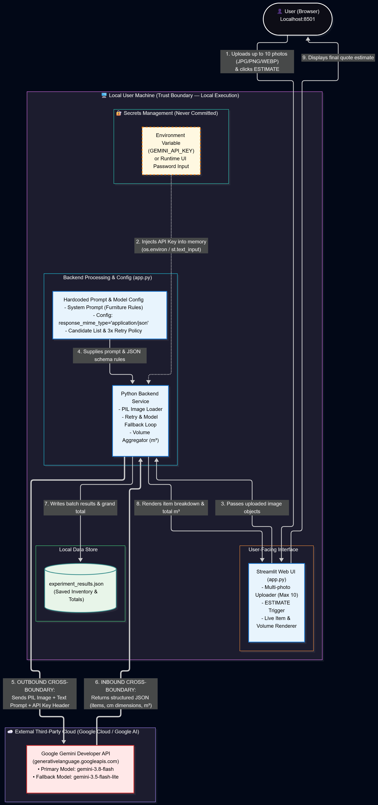

MOVING QUOTE AI — SETUP & RUN INSTRUCTIONS (FROM SCRATCH)

Note: The `venv` (virtual environment) folder is intentionally excluded 
from the GitHub repository to keep the download size small. All setup 
and run commands must be executed inside the `moving_quote_ai_without_venv` 
subfolder.

Prerequisites:
- Python 3.9 or higher installed on your machine
- A free Gemini API Key from Google AI Studio (https://aistudio.google.com/)

STEP 1: Clone the Repository and Navigate to the App Subfolder
Open your terminal (or VS Code Terminal) and run:

    git clone https://github.com/mauricekamkoum-stack/moving-video-ai.git
    cd moving-video-ai/moving_quote_ai_without_venv

(Make sure your terminal path ends in `\moving_quote_ai_without_venv` 
before proceeding to Step 2).

--------------------------------------------------------------------
STEP 2: Create and Activate a Virtual Environment (`venv`)

Inside `moving_quote_ai_without_venv`, create and activate a fresh 
virtual environment:

  * On Windows (PowerShell):
    python -m venv venv
    Set-ExecutionPolicy -ExecutionPolicy RemoteSigned -Scope Process
    venv\Scripts\activate

    (Note: The `Set-ExecutionPolicy` command prevents Windows PowerShell 
    from blocking the activation script. If Windows Defender prompts a 
    security notice during setup, click "Allow on device").

  * On macOS / Linux:
    python3 -m venv venv
    source venv/bin/activate

You should now see `(venv)` at the beginning of your terminal prompt.

--------------------------------------------------------------------
STEP 3: Install Required Dependencies
With `(venv)` active, install all required Python libraries in one command:

    pip install -r requirements.txt

(If `requirements.txt` is not present, run:
    pip install google-genai pillow streamlit)

--------------------------------------------------------------------
STEP 4: Configure Your Gemini API Key

Set your API key as an environment variable in your active terminal 
(Note: terminal environment variables reset if you close the terminal):

  * On Windows (PowerShell):
    $env:GEMINI_API_KEY="your_actual_api_key_here"

  * On macOS / Linux:
    export GEMINI_API_KEY="your_actual_api_key_here"

(Alternatively, if you skip this step, the web app will ask you to 
paste your API key directly into a password box when it opens).

LINK ABOVE FOR THE WEBSITE

--------------------------------------------------------------------
STEP 5: Launch the Application

Start the web interface by running:

    streamlit run app.py

Your default web browser will automatically open at http://localhost:8501.
1. Drag and drop up to 10 apartment photos into the upload box.
2. Click the "ESTIMATE" button.
3. View the detected furniture, dimensions, and total volume (m³) live 
   on screen and saved in `experiment_results.json`.

====================================================================
TROUBLESHOOTING QUICK TIPS:

- "Error: Invalid value: File does not exist: app.py":
  You are likely in the root `moving-video-ai` folder. Run 
  `cd moving_quote_ai_without_venv` and try again.
- "ModuleNotFoundError: No module named 'google' or 'streamlit'":
  Make sure your virtual environment is active (`(venv)` is visible 
  in your terminal) before running `streamlit run app.py`.
- "503 UNAVAILABLE / High Demand":
  The app automatically retries and falls back across multiple Gemini 
  models (`gemini-3.8-flash` and `gemini-3.5-flash-lite`). If Google's 
  free-tier servers experience a brief traffic spike, wait 10 seconds 
  and click ESTIMATE again.

ARCHITECTURE DIAGRAM:
## Architecture
